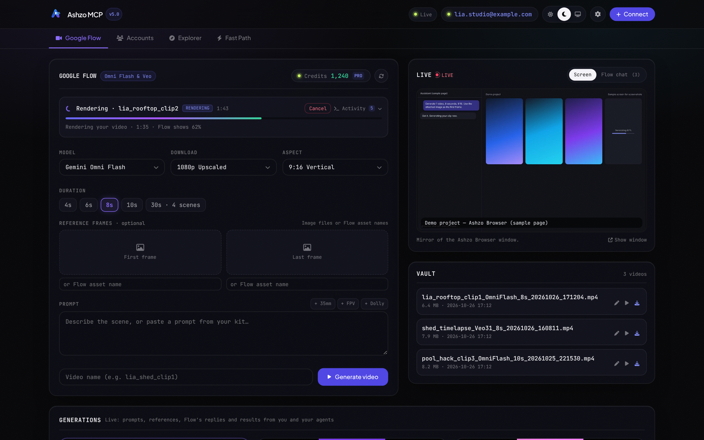
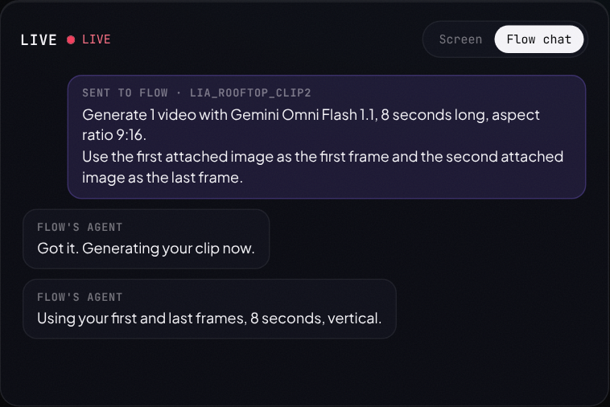
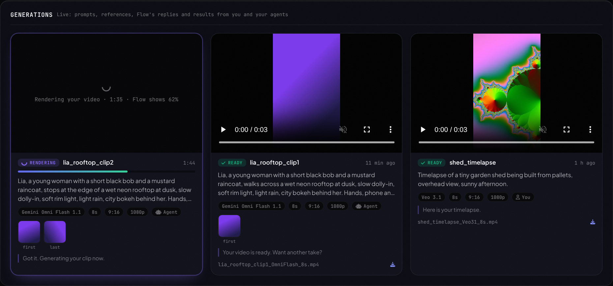
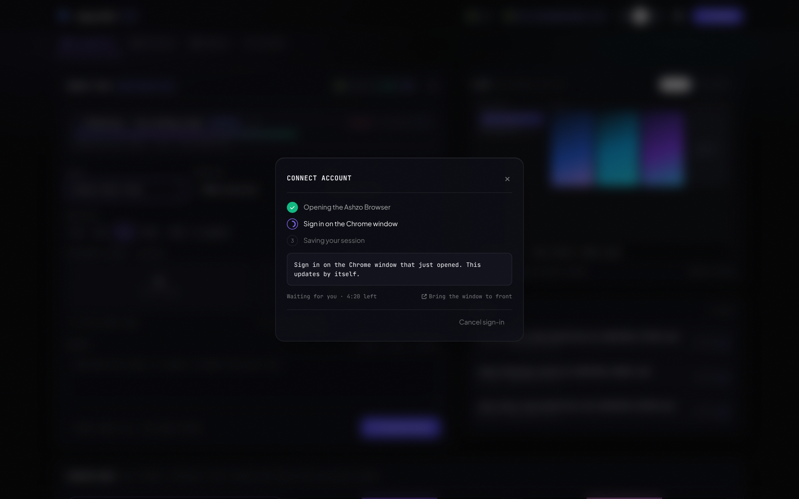
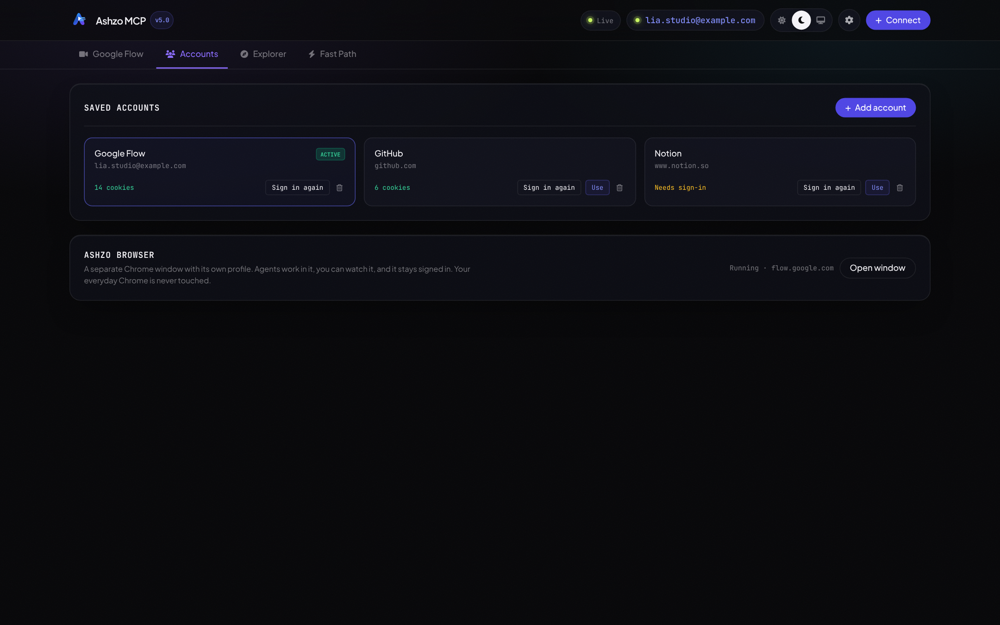
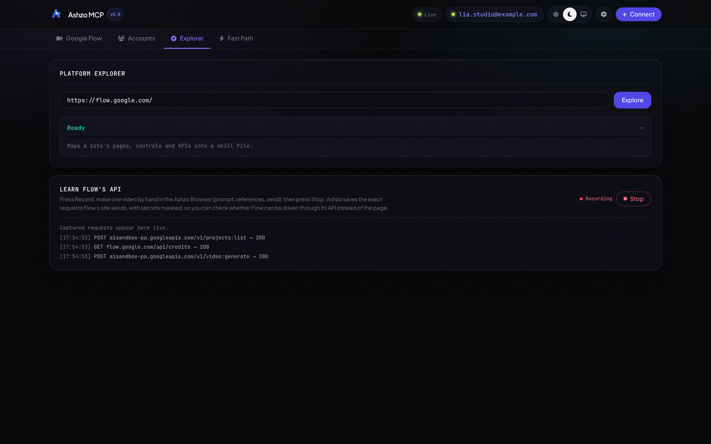
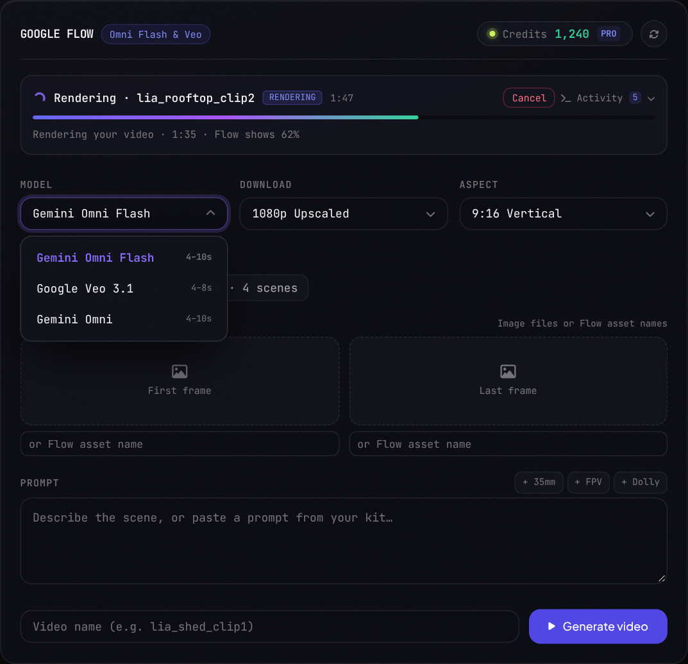
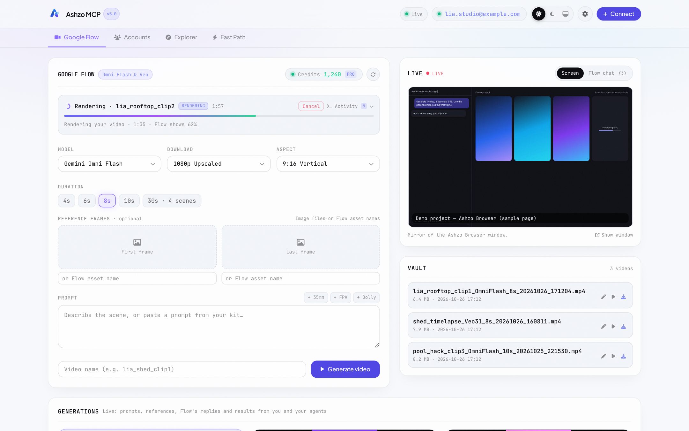
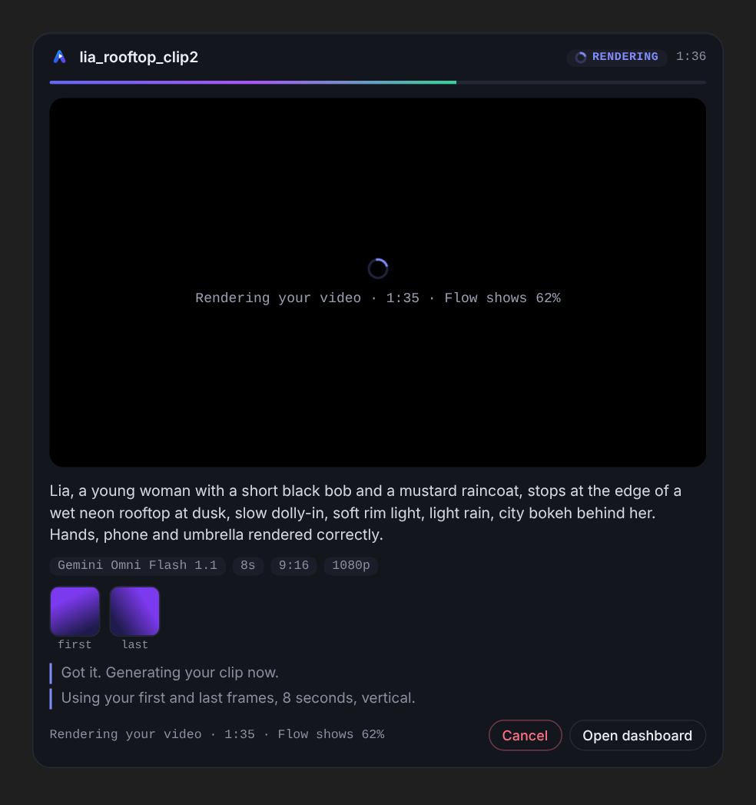

# Ashzo MCP

[](https://modelcontextprotocol.io/)
[](https://playwright.dev/)
[](https://python.org/)
[](LICENSE)

Ashzo MCP lets an AI agent (Claude, Cursor, Antigravity, Codex, ...) work with websites quickly, and lets **you watch it happen live**.

- **A live dashboard** at `http://localhost:8000`: a live feed, progress, the Flow chat, the agent's browser, and every video it makes, appearing as it happens. No refresh needed.
- **A real signed-in browser** (the *Ashzo Browser*) the agent drives and you can watch. You sign in once.
- **A fast way to read any site's data**: it learns a site's own JSON API and calls it directly, instead of clicking through pages.
- **A Google Flow video generator** that runs inside the Ashzo Browser, with a playbook for recreating videos.
- **A live card inside chats** (in apps that support MCP Apps) that shows a video being made, like the Higgsfield card.



---

## Quick start

**Windows:** double-click **`CREATE_DESKTOP_ICON.bat`**. It sets up `.venv`, installs everything, and puts an **Ashzo MCP** icon on your desktop. Double-click the icon any time: it starts the local server and opens the dashboard in your default browser.

**macOS / Linux:**

```bash
python3 -m venv .venv && .venv/bin/pip install -r requirements.txt
.venv/bin/python -m playwright install chromium
.venv/bin/python create_desktop_shortcut.py     # desktop icon
.venv/bin/python launch_ashzo.py                # or just start it now
```

No icon? `START_ASHZO.bat` (Windows) or `python launch_ashzo.py` does the same thing. Server output goes to `logs/ashzo_server.log`.

AI agents working in this repo are told (in [AGENTS.md](AGENTS.md), `CLAUDE.md` and the Cursor/Antigravity rules) to create the icon on a new computer and tell you where it is.

### Run with Docker (any OS, no Python setup)

You need [Docker Desktop](https://www.docker.com/products/docker-desktop/) (Windows, macOS) or Docker Engine (Linux).

**Windows, no commands:** double-click **`CREATE_DOCKER_ICON.bat`** once. It builds the app and puts an **Ashzo MCP (Docker)** icon on your desktop. From then on, double-click that icon: it starts Docker Desktop if needed, starts the app and opens the dashboard.

**Or from a terminal**, in this folder:

```bash
docker compose up -d --build
```

The first build takes a few minutes (it downloads Chromium). After that:

- **Dashboard:** http://localhost:8000
- **Ashzo Browser:** http://localhost:6080/vnc.html. This is the browser the agent works in. Open it once to sign in to Google (for Flow). It is a live view of the browser running inside the container. In the dashboard, **Connect** and the **Open browser view** buttons open it for you in a new tab.
- **Your data** (sign-ins, settings, downloads) is kept in the Docker volume `ashzo-data`, so it survives restarts and rebuilds. Your downloaded videos are in there too.

Useful commands:

```bash
docker compose logs -f ashzo      # server output
docker compose down               # stop (keeps your data)
docker compose down -v            # stop and delete all saved data
```

Ports are bound to `127.0.0.1`, so only this computer can reach them. To protect the noVNC view with a password, create a `.env` file next to `docker-compose.yml` containing `VNC_PASSWORD=your-password`, then run `docker compose up -d`.

**Connect Claude (Windows):** the `CREATE_DOCKER_ICON.bat` setup also registers Ashzo with **Claude Desktop** and **Claude Code**, so there's nothing to type. Quit Claude Desktop completely and open it again. Claude Code picks it up in new sessions. Your existing Claude settings are kept, and a `.bak` copy of each config is made first.

For other AI apps, or to set it up by hand, use `docker exec` instead of a local Python path. The MCP server runs inside the container and sends its events to the dashboard:

```json
{
  "mcpServers": {
    "ashzo-mcp": {
      "command": "docker",
      "args": ["exec", "-i", "-e", "ASHZO_DASHBOARD_URL=http://127.0.0.1:8000", "ashzo-mcp", "python", "server.py"]
    }
  }
}
```

Limits of the container: Google may ask for extra checks when you sign in from a container, and Flow's pages can change, as they can with the native install. Sign-in and Flow work are not verified in every setup.

### Connect it to your AI app

Add the server to your MCP config (Claude Desktop: `claude_desktop_config.json`; Cursor: `.cursor/mcp.json`). Use the full paths on your computer (this is the native install; for Docker, use the `docker exec` config above):

```json
{
  "mcpServers": {
    "ashzo-mcp": {
      "command": "<repo>/.venv/Scripts/python.exe",
      "args": ["<repo>/server.py"],
      "env": { "PYTHONUNBUFFERED": "1" }
    }
  }
}
```

(macOS / Linux: `<repo>/.venv/bin/python`.) The MCP process forwards its events to the dashboard, so the dashboard shows what the agent does even when the agent starts the server itself. Keep the dashboard open (use the desktop icon) to watch.

---

## The dashboard

Everything below updates live while an agent works through the MCP.

| | |
| :--- | :--- |
| **Live View + Flow chat.** The Ashzo Browser's screen, Google Flow's own chat replies, and a progress bar. |  |
| **Generations.** Each video appears as a card: the video, the prompt, model, settings and the reference frames it used. |  |
| **Connect.** Sign in to a site once in the Ashzo Browser. Progress is live, and the dialog never gets stuck on "Launching Chrome". |  |
| **Accounts.** Saved sessions. Signing in again updates the account instead of adding a duplicate. |  |
| **Explorer.** Point it at any URL; it maps the page and the site's APIs and writes a skill file for agents. |  |
| **Menus are overlays.** Opening a dropdown never moves the layout. |  |

Light and dark themes (and *system*), with a circular reveal when you switch:



### The live card inside a chat

When an agent calls `flow_generate_video`, apps that support **MCP Apps** (Claude desktop and web, ChatGPT and VS Code, at the time of writing) show a live card in the conversation: progress, the video, the prompt, reference frames, the last Flow replies, and a Cancel button.



Notes:

- Hosts that don't support MCP Apps still get the normal text result, and the dashboard still shows everything.
- The card tries to play the video from the local dashboard first. If the chat app blocks that, it loads the video in small pieces through the MCP connection instead.
- This part needs `mcp` 2.3 or newer (`pip install -U mcp`). With older versions the server works as before, without the card.

---

## How it reads websites: 3 tiers

```
 agent ── universal_request(url) ──►  Tier 1  Fast Path     replay a learned JSON/GraphQL API with your saved session
                                        │ no route yet, or refused
                                        ▼
                                      Tier 2  Discovery     open the page, watch its network traffic, learn the API, save it
                                        │ the page has no JSON API
                                        ▼
                                      Tier 3  Page text     clean Markdown / accessibility tree from the page
```

**Fast Path is self-healing.** If a site refuses the saved session (401/403, or it sends you to a sign-in page), Ashzo opens the site in the Ashzo Browser, lets the site renew its own cookies, notes the fresh request headers (kept in memory for 15 minutes, never written to disk), and tries again. It retries with backoff (up to 5 tries and 2 session renewals per call). If it still can't, it falls back to the browser tiers and says so. After 3 failures in a row a route is paused for 30 minutes, unless you sign in again.

**It asks for exactly the URL you asked for.** A learned route only supplies the site's headers and auth. It never replaces your URL, so you can't get another page's data.

What the Fast Path cannot do (it falls back to Tier 2 or 3 automatically):

- sites whose tokens are very short-lived or signed per request;
- sites with anti-bot protection or CAPTCHAs (Ashzo does not try to get around those);
- pages that are plain HTML with no JSON API behind them.

### Speed and tokens (measured)

Measured on a local test setup. Your numbers will differ by site and network, so treat them as a guide:

| | Browser (Tier 2/3) | Fast Path (Tier 1) |
| :--- | :--- | :--- |
| Local test API | about 139 ms (warm browser) | about 5 ms |
| Real sites | the page has to load and render | about 5 to 30 times faster than loading the page |

Tokens: driving a browser with screenshots costs roughly 1,000 to 1,500 tokens per screenshot, and the context grows with every step. Ashzo's tools return small structured results instead. The tool list costs about 2.3k tokens once per conversation, a status check about 130 tokens, and a full Flow video about **2k tokens** (one `flow_generate_video` plus a few `flow_job_status` calls).

---

## MCP tools

| Tool | What it does |
| :--- | :--- |
| `universal_request(url, method, params, body, force_tier)` | The main tool. Tries Fast Path, then learns the API, then reads the page. Returns what happened in `notes`. |
| `discover_routes(url, interactive_action)` | Opens the page and learns its background APIs. |
| `get_page_content(url, mode)` | Clean page text and/or accessibility tree. |
| `authenticate_session(target_url, timeout_seconds)` | Opens the Ashzo Browser so you can sign in once. Progress is shown live. |
| `sync_chrome_session(profile_name_or_email)` | Copies cookies from a local Chrome profile (Windows). |
| `list_learned_routes(domain)` / `clear_cache(domain)` | See or clear learned routes and sessions. |
| `open_live_view()` | Starts the Ashzo Browser and mirrors it into the dashboard. |
| `flow_generate_video(prompt, model, duration, aspect_ratio, download_quality, starting_frame_image, ending_frame_image, slug, wait)` | Generates a video in Google Flow. Returns at once; shows the live card in chats that support it. |
| `flow_job_status(wait_seconds)` | Waits up to 55 s for progress, then returns a small status. |
| `flow_cancel_job()` | Cancels the running generation. |
| `get_flow_account_credits()` | Real credits from your account (never guessed). |
| `validate_flow_prompt(...)` | Checks a prompt against the model's limits. |
| `study_video(path)` | Breaks a source video into scene cuts, contact sheets, audio analysis. Step one of recreating a video. |

### Google Flow

- [GOOGLE_FLOW_SKILL.md](GOOGLE_FLOW_SKILL.md) is the playbook for agents. Sections 0 and 0.5 are mandatory: generate visibly in the Ashzo Browser, report only real credits, never bypass CAPTCHAs.
- [VIDEO_RECREATION_SKILL.md](VIDEO_RECREATION_SKILL.md) is the video-recreation workflow, and Flow work uses it every time a video is being recreated.
- Flow has no public API. Generation drives Flow's own web page, so its buttons and menus can change; if Flow changes its layout, the selectors in `flow_video_automator.py` are the place to fix. Everything the automation does is visible in Live View.
- Generated files are saved to `downloads/` and listed in the dashboard.

---

## Settings

Open **Settings** in the dashboard (stored in `ashzo_settings.json`): your Flow project link, whether the Ashzo Browser window is shown, the browser's debug port (default 9333), sign-in and render timeouts, and the default aspect ratio.

---

## Security and privacy

- The server listens on `127.0.0.1` only, and rejects requests from other websites (host and origin checks).
- Cookies are only ever sent to their own site. Secrets are masked in logs and in files (`ya29...7890`).
- Sessions, cookies, learned routes and downloads stay on your computer and are in `.gitignore`. Fresh request headers captured during self-repair are kept in memory only.
- In stdio mode nothing is printed to stdout (that would break the MCP protocol); logs go to stderr and `logs/`.
- Ashzo reuses *your own* signed-in browser. It does not solve CAPTCHAs or get around anti-bot checks.

---

## Development

```bash
python scripts/verify_dashboard.py       # checks layout, spinner, theme, live updates, no console errors
python scripts/capture_screenshots.py    # refreshes docs/screenshots
python test_server.py                    # the original engine tests
npm install && npm run build:css         # only after changing Tailwind classes in web/
```

The dashboard is plain HTML/JS with locally compiled Tailwind, fonts and icons (no CDNs), so it works offline. Rules for contributors and agents are in [AGENTS.md](AGENTS.md).

Key files: `server.py` (MCP tools), `app.py` (dashboard server and live events), `browser_hub.py` (the Ashzo Browser), `session_refresh.py` (Fast Path self-repair), `flow_video_automator.py` (Flow jobs), `web/chat_card.html` (the in-chat card).

---

## License

MIT. See [LICENSE](LICENSE).
